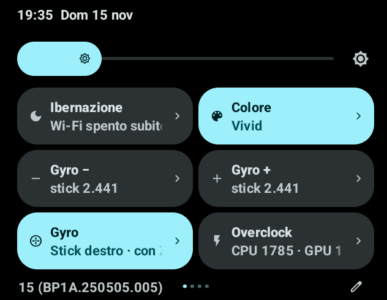
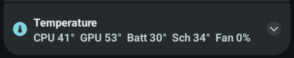
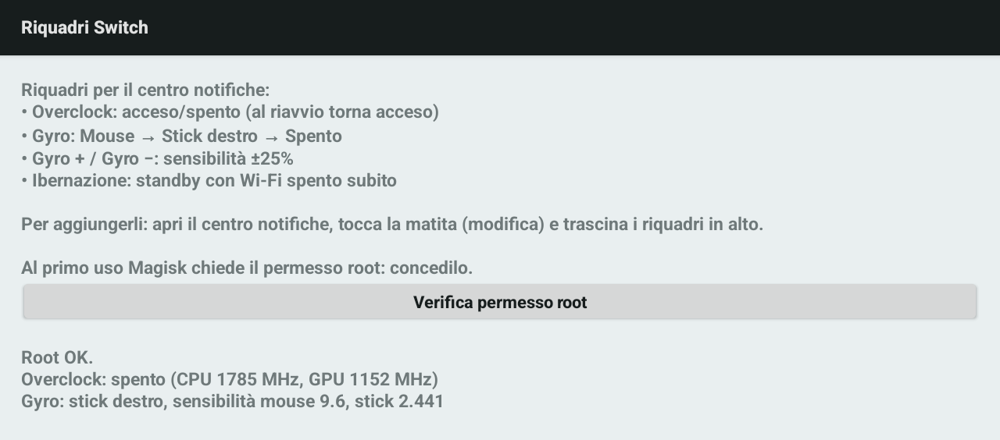

# 🎮 Android Enhancement NX — making Android on the Nintendo Switch (NX) feel like a finished handheld

-167C80)   

**Root services, native tools and a Quick Settings app that fix the rough edges of
[Switchroot LineageOS](https://wiki.lineageos.org/devices/nx_tab/) on the Switch OLED: lost Joy-Con rumble,
Wi-Fi drops while streaming, battery drain in standby, a "ghost" external display and more.**
Every fix started from a real bug on real hardware, was traced to its root cause in logs and kernel sources,
and was tested on the console.

| Quick Settings tiles | Live temperatures | Gyro and overclock status |
|---|---|---|
|  |  |  |

All captured on the console (Switch OLED, LineageOS 22.2): the tiles drive the gyro service (mouse → right stick → off, sensitivity ±25%), the overclock and hibernation; the notification reads CPU, GPU, battery, screen and fan in real time.

### What's inside
| Folder | What it fixes / adds |
|---|---|
| [`joycond-fix/`](joycond-fix) | **`jcfix`**, an `LD_PRELOAD` library for joycond. Android re-sends "play" on every rumble update (e.g. GeForce NOW) and joycond drops the rumble; jcfix filters repeated plays and stops stuck vibration. Rumble works in cloud gaming, Moonlight and emulators |
| [`gyromouse/`](gyromouse) | **Gyro aiming** in C: the Joy-Con gyroscope drives a virtual mouse, or is blended into the right stick through a cloned `uinput` controller (`EVIOCGRAB`), only in the apps you choose, with rumble forwarded |
| [`wifi/`](wifi) | **Stable Wi-Fi for streaming**: no roaming while connected, power-save off, outage logging, and automatic detection of a wedged BCM4356 firmware with a clean reboot instead of a kernel panic |
| [`battery-standby/`](battery-standby) | **Light standby** (Joy-Con input grabbed so a stray press can't wake the console, Bluetooth off, Wi-Fi kept for 10 min then Doze) and **hibernation** (full power-off after a timeout on battery) |
| [`profiles/`](profiles) | **Per-app profiles** (trigger mode, fan curve, capped overclock while streaming because video is hardware-decoded), **OLED colour modes** via the panel's own presets, **ghost external display fix** via debugfs hotplug, temperatures in a notification |
| [`quick-tiles/`](quick-tiles) | **Riquadri Switch**, an Android app with Quick Settings tiles: overclock, gyro mode and sensitivity, OLED colour, instant hibernation, temperature notification. Built without Gradle |
| [`emulators/`](emulators) | Azahar (3DS) layout that switches automatically when **AR glasses** are plugged in: touch screen on the Switch, top screen in side-by-side 3D on the glasses. Never closes a running game |
| [`restore-kit/`](restore-kit) | One-command backup and restore of all the customisations from a PC over ADB (no logins or tokens saved) |
| [`docs/`](docs) | Step-by-step Android install guide that never touches the internal eMMC, plus research reports on display and system improvements |

### Try it
Requirements: Switch with Switchroot LineageOS 22.2 (nx_tab), Magisk root, `adb` on a PC.
1. Download the prebuilt binaries and the tiles APK from the
   [latest release](https://github.com/rikyroky91-commits/android-enhancement-nx/releases/latest), or build them
   (static aarch64, e.g. `zig cc -target aarch64-linux-musl -static -O2 gyromouse.c -o gyromouse`).
2. Copy the binaries to `/data/adb/gyromouse/` and the `*.sh` services you want to `/data/adb/service.d/`
   (`chmod 755`), then reboot. Each script starts with a comment describing what it does and its settings.
3. Install `RiquadriSwitch.apk` and add the tiles from Quick Settings.

> ⚠️ These scripts run as root on a modded console. Read each one before installing and keep a backup
> (`restore-kit/`). Never run `dumpsys wifi` on this hardware: it crashes the Wi-Fi HAL.

### Tech
C (Linux input/`uinput`, force feedback, `EVIOCGRAB`, `LD_PRELOAD` hooking) · POSIX shell on toybox/busybox ·
Magisk service.d · Android framework internals (`cmd`, `dumpsys`, settings, Doze) · Java (TileService) ·
sysfs/debugfs on NVIDIA Tegra X1 · ADB

### Credits
Built on [Switchroot](https://switchroot.org/) LineageOS, [hekate](https://github.com/CTCaer/hekate),
[Magisk](https://github.com/topjohnwu/Magisk) and [joycond](https://github.com/DanielOgorchock/joycond).
Not affiliated with Nintendo.

---

## 🇮🇹 In breve

Servizi root, strumenti in C e un'app di riquadri rapidi che rendono Android (LineageOS) sulla Switch OLED
usabile tutti i giorni: vibrazione dei Joy-Con che non si perde più nel cloud gaming, mira col giroscopio,
Wi-Fi stabile per lo streaming, standby che non scarica la batteria, schermo esterno fantasma eliminato, profili
automatici per app, colori del pannello OLED e kit di ripristino. La guida di installazione completa è in
[docs/installazione-android-switch.md](docs/installazione-android-switch.md); ogni script spiega in testa cosa fa.
